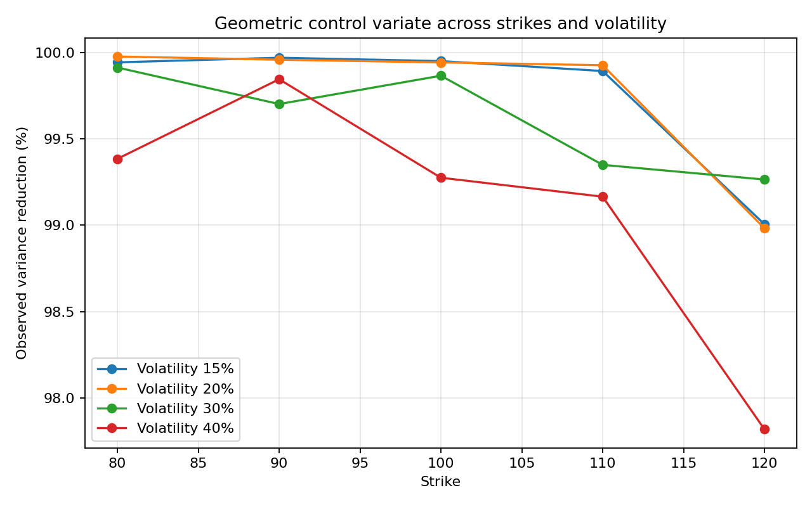
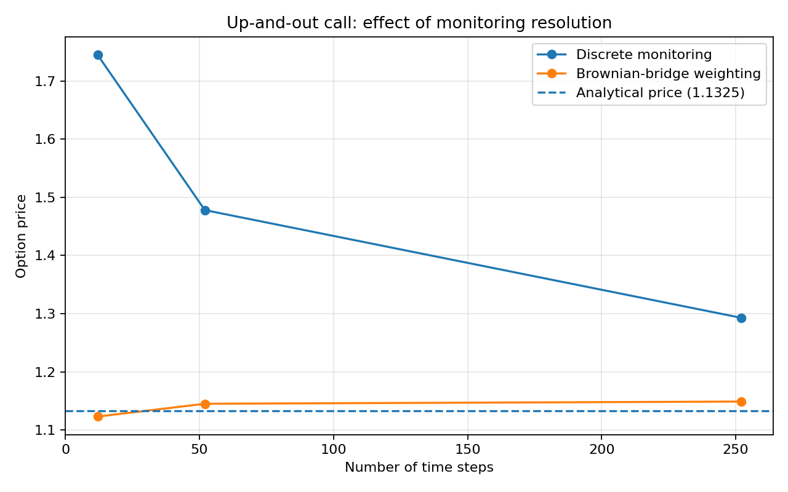
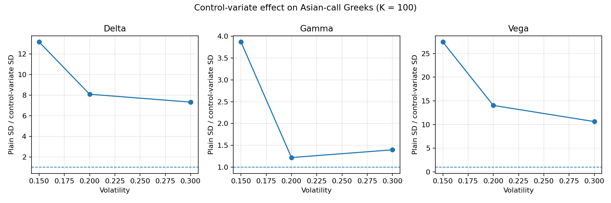

# Exotic Derivatives Pricing

This is a Python project where I practise Monte Carlo pricing for options that depend on a stock's path over time.

It covers:
- Simulating stock prices with geometric Brownian motion.
- Pricing European and Asian calls.
- Using a geometric Asian option to improve Monte Carlo estimates for an arithmetic Asian option.
- Estimating Delta, Gamma and Vega.
- Pricing an up-and-out barrier call, with and without a Brownian-bridge correction.

## Setup

You need Python 3.10 or newer. From the project folder, run:

```bash
python -m venv .venv
```

Activate the environment.

Windows PowerShell:

```powershell
.venv\Scripts\Activate.ps1
```

macOS or Linux:

```bash
source .venv/bin/activate
```

Install the packages:

```bash
python -m pip install -r requirements.txt
```

## Run the tests

```bash
python -m pytest -q
```

## Run the experiments

Run these commands from the project folder:

```bash
python experiments/variance_reduction.py
python experiments/greeks.py
python experiments/barrier_convergence.py
python experiments/make_plots.py
```

The first three scripts save their results as CSV files in `outputs/`. The last script makes the plots shown below. The experiments use fixed random seeds so they can be repeated.

## Results

### Asian option: control variate

The geometric Asian option has a known price under our model. We use it to reduce noise when pricing an arithmetic Asian option. The benefit changes with the strike and volatility, so the results should not be treated as a rule that always holds.



### Barrier option: Brownian bridge

A barrier option can be knocked out if the stock touches a set price. If we only simulate a few dates, we can miss a crossing between dates. Brownian-bridge weighting estimates the chance of a crossing between two simulated prices.



### Asian option Greeks

We also compare the variability of Monte Carlo estimates for Delta, Gamma and Vega. The control variate helps some estimates more than others; Gamma is particularly sensitive to the numerical setup.



## Assumptions

The stock follows geometric Brownian motion with constant volatility, interest rate and dividend yield. Asian options use equally spaced fixing dates. The barrier example is an up-and-out call with continuous monitoring and no rebate.

These are learning experiments, not production pricing tools. The results depend on the model and simulation settings, and the Greek estimates depend on the finite-difference bump sizes. The methods used here are standard; this project is an implementation and comparison of them, not a claim to have invented them.
